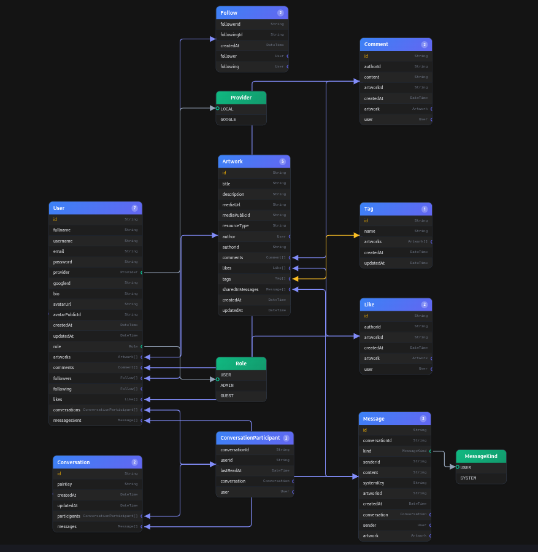

*This project has been created as part of the 42 curriculum by <trindran>, <cramaros>, <nrakotom>, <srabeman>*

## Description
## Instruction
## 📚 Resources
### Official Documentation

- **NestJS**: [Official Documentation](https://docs.nestjs.com/)
- **Prisma**: [Official Documentation](https://www.prisma.io/docs)
- **Socket.IO**: [Official Documentation](https://socket.io/docs/v4/)
- **React**: [Official Documentation](https://react.dev/)

### Video Tutorials

- **NestJS**: [Anson](https://youtu.be/uWZ_6pDbLpU)
- **Prisma**: [Web Dev Simplified](https://www.youtube.com/watch?v=RebA5J-rlwg&t=3018s)
- **Socket.IO**: [Marius Espejo](https://youtu.be/atbdpX4CViM)
- **Cloudinary**: [Cloudinary](https://youtu.be/l7TUGdRN-f0)
## Team Information:
## Project Management:
## Technical Stack:
 - Backend :
   - NestJS
   - Prisma
   - PostgreSQL
- Frontend :
  - React
  - TypeScript

  
## Database Schema:

## Features List:

## Modules:
 - Major :
    - [x] Use a framework for the frontend and backend(React, NestJS).
    - [x] Implement real-time features using WebSockets or similar technology.
    - [] Allow users to interact with other users
	
    - [x] Advanced Permission System *(frontend committed; backend changes are local & uncommitted — see `local_backend_changes.md`)*
    - [] Standard user management and authentication
	- [x] Module of choice (infinite canvas)
	- [] Monitoring system with Prometheus and Grafana.
	

 
- Minor :
    - [x] Use a frontend framework (React).
    - [x] Use a backend framework (NestJS).
    - [x] Use an ORM (Prisma) for the database.
    - [x] Health check and status page system with automated backups and disaster recovery procedures.
    - [x] A complete notification system for all creation, update, and deletion actions.
    - [x] File upload and management system
    - [x] Custom-made design system with reusable components, including a proper color palette, typography, and icons.
	- [x]  Implement advanced search functionality with filters, sorting, and pagination.
    - [x] Multilingue
    - [x] Support for additional browsers
    - [x] RTL Arabic
    - [x] GDPR compliance features *(frontend committed; backend changes are local & uncommitted — see `local_backend_changes.md`)*
	- [] file upload
	- [] Oauth2.0 authentication with Google or 42 API
	- [] User activity analytics and insights dashboard

Excpected points: 23/28

## Individual Contributions:
- trindran :
  - create prisma schema  
  - Implement basis user CRUD with the dto validation
  - Upload avatar, file and artwork with dto validation
  - follow, like, comment friendship system with dto validation
  - Role based access control for USER/ADMIN with dto validation
  - Online status with socket.io
  - Search system with filters, sorting and pagination

- nrakotom :
- cramaros :
  - Set up the complete development environment (frontend, backend, Docker, and service dependencies).
  - Implemented the health monitoring system, including health checks, the status page, automated PostgreSQL backups, and disaster recovery procedures.
- srabeman :

